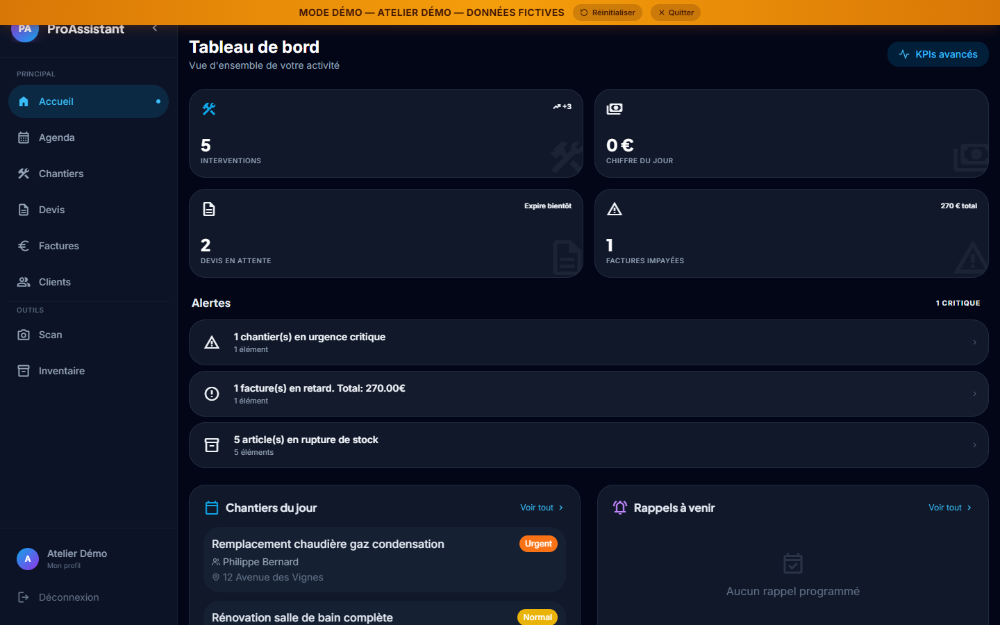

# ProAssistant IA — l'outil métier des artisans

**▶ Démo en 1 clic : [proassistant.rvlts.com/demo](https://proassistant.rvlts.com/demo)** — entreprise fictive « Atelier Démo », données fictives réinitialisées, aucune inscription.
Par [John Dossin](https://dossin.rvlts.com) · portfolio complet : [dossin.rvlts.com](https://dossin.rvlts.com)

**Dicter une intervention les mains dans le vide sanitaire, sans réseau — et ressortir un devis.**
Gestion complète de chantier pour artisans : devis, agenda, chantiers, clients, stock, équipe, photos analysées.

> ℹ️ Ce dépôt est une **vitrine** : le code source est privé (données clients des artisans). Accès en lecture sur demande pour un entretien — dossinjohn@gmail.com.

## Pour qui

Plombiers, électriciens, indépendants du bâtiment — **mon ancien métier**. Je connais le vide sanitaire, pas seulement le persona.

## Décisions d'ingénierie

- **Une phrase dicte l'architecture** : « les mains sales, sans réseau, pas de clavier » → voice-first, transcription locale, structuration par LLM plutôt qu'un formulaire.
- **Whisper en local, pas en API** — la voix d'un client et l'adresse d'un chantier ne quittent le serveur que pour la structuration : la confidentialité client fait partie de l'architecture.
- **Multi-tenant JWT dès la première ligne** — chaque artisan ne voit que ses chantiers, ses clients, ses prix.
- **Vision par photo** — photographier un devis ou un matériau suffit : l'analyse remplit l'inventaire et les lignes de devis.
- **Facturation volontairement verrouillée** — facturer pour un artisan belge, c'est la TVA et la e-facturation structurée (Peppol). Je ne mets pas en ligne un générateur de factures à moitié conforme.

## Stack

| Couche | Technologies |
|---|---|
| Web | React 18 · TypeScript · Tailwind |
| API | Express 4 · Prisma · PostgreSQL · JWT multi-tenant |
| IA | Whisper local (transcription) · Gemini 1.5 Flash (structuration, vision) |
| Exploitation | PM2 · nginx · TLS · VPS administré par moi |

## Décidé · Délégué · Vérifié

| Décidé (moi) | Délégué (agents IA) | Vérifié (moi) |
|---|---|---|
| Voice-first comme produit, pas comme gadget | Écriture des modules | Parcours dictée → devis testé de bout en bout |
| Whisper local (confidentialité) | Modèle Prisma et CRUD | Isolation entre artisans (tenants) vérifiée |
| Facturation verrouillée (TVA / Peppol) | Frontend du tableau de bord | Démo à données fictives réinitialisables |
| Périmètre module par module selon le terrain | | |
